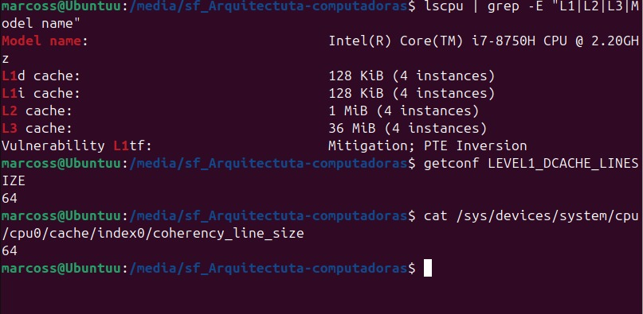
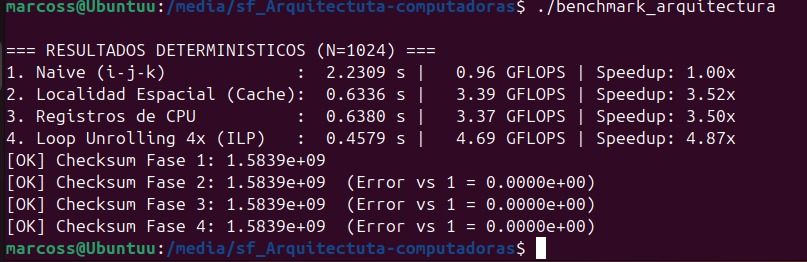

# Informe de laboratorio: optimización en la jerarquía de memoria

**Universidad Católica Boliviana “San Pablo”** — UAR Santa Cruz  
**Carrera:** Ingeniería de Software  
**Asignatura:** Arquitectura de Computadoras (SIS-131)  
**Docente:** Ing. Paulo César Loayza Carrasco  
**Entorno:** GNU/Linux Ubuntu en VirtualBox  
**Carpeta de trabajo:** `/media/sf_Arquitectura-computadoras`  
**Fecha:** 16 de septiembre de 2026

---

## 1. Objetivos

- Medir la penalización de un *cache miss* frente a un *cache hit* en el producto matricial \(C = A \times B\) con \(N = 1024\).
- Comprobar el aprovechamiento de la línea de caché de **64 bytes**.
- Relacionar registros de CPU (FPU/ALU) con localidad temporal.
- Observar el efecto del *loop unrolling* 4× sobre el ILP.
- Calcular speedup \(S = T_{\text{base}} / T_{\text{opt}}\) y rendimiento en GFLOPS.

---

## 2. Verificación previa del hardware

Comandos ejecutados:

```bash
lscpu | grep -E "L1|L2|L3|Model name"
getconf LEVEL1_DCACHE_LINESIZE
cat /sys/devices/system/cpu/cpu0/cache/index0/coherency_line_size
```



| Recurso | Valor observado |
|---------|-----------------|
| CPU | Intel Core i7-8750H @ 2.20 GHz |
| L1d | 128 KiB (4 instancias) |
| L1i | 128 KiB (4 instancias) |
| L2 | 1 MiB (4 instancias) |
| L3 | 36 MiB (4 instancias) |
| Línea L1 (`getconf`) | **64 bytes** |
| *Coherency line size* | **64 bytes** |

**Principio físico:** \(64 / 4 = 16\) números `float` por línea. El bus trae 16 elementos contiguos aunque el programa pida uno.

---

## 3. Compilación y ejecución

Nivel de optimización **oficial `-O1`**: no reordena bucles como `-O3`, así que el tiempo refleja el orden de accesos del código.

```bash
gcc -Wall -Wextra -O1 benchmark_arquitectura.c -o benchmark_arquitectura -lm
./benchmark_arquitectura
```

No se usó `perf`: en VirtualBox los contadores PMU suelen no estar expuestos. Las métricas de este informe son tiempos, GFLOPS, speedup y checksum.

---

## 4. Resultados experimentales



Operaciones de punto flotante del producto: \(2 N^3\) (un mul y un add por terna \(i,j,k\)).

\[
\text{GFLOPS} = \frac{2 \cdot 1024^3}{10^9 \cdot T}
\]

| Fase / configuración | Tiempo (s) | Rendimiento (GFLOPS) | Speedup | Tasa de acierto (cualitativa) |
|----------------------|------------|----------------------|---------|-------------------------------|
| 1. Naive (i-j-k) | 2.2309 | 0.96 | 1.00× (base) | Baja |
| 2. Localidad espacial (i-k-j) | 0.6336 | 3.39 | 3.52× | Alta |
| 3. Registros de CPU | 0.6380 | 3.37 | 3.50× | Óptima (acceso ya contiguo) |
| 4. Loop unrolling 4× (ILP) | 0.4579 | 4.69 | 4.87× | Máxima |

**Validación:** checksum \(1.5839 \times 10^9\) idéntico en las cuatro fases (error \(0.0000 \times 10^0\)). Las variantes son equivalentes matemáticamente.

### Lectura de los tiempos

- El salto de **2.23 s → 0.63 s** (fase 1 a 2) es el efecto dominante: dejar de saltar 4096 bytes en `B[k][j]` y recorrer filas contiguas.
- La fase 3 queda **casi igual** a la 2 (~0.6 % más lenta). Con `-O1`, `float r` de la fase 2 ya vive en registro; `register const float reg_a` no añade un ahorro extra medible.
- La fase 4 sí baja a **0.46 s** (4.87×): menos ramas del bucle interno y más trabajo independiente por iteración (ILP).

---

## 5. Cuestionario de análisis crítico

### Pregunta 1 — Líneas de caché

Una línea de 64 B y `sizeof(float) = 4` B dan:

\[
\frac{64}{4} = 16
\]

accesos consecutivos por cada carga de línea a L1.

En la fase 2, `B[k][j]` y `C[i][j]` avanzan de a 1 en `j`. El primer `float` de cada línea produce *miss*; los 15 siguientes son *hit* si no hay reemplazo:

\[
\text{Hit rate teórico} = \frac{15}{16} = 0.9375 = 93.75\%
\]

En la fase 1, el índice interno `k` recorre `B[k * N + j]` con stride \(N \times 4 = 4096\) B, mayor que 64 B: casi cada lectura es *miss* (se desecha el 93.75 % de la línea).

### Pregunta 2 — Localidad temporal y registros

`A[i][k]` no cambia mientras corre `j = 0 … 1023`. Guardarlo en un registro de la FPU evita **1024 relecturas** de esa celda por cada par \((i,k)\).

El registro está en el datapath del núcleo; no usa el bus de memoria ni ocupa una línea de caché extra. La RAM queda para `B` y `C`, que sí varían con `j`.

### Pregunta 3 — Loop unrolling e ILP

El número de sumas y multiplicaciones es el mismo (\(2N^3\)). Cambia el **control del bucle**:

- menos incrementos, comparaciones y saltos (`j += 4` en lugar de `j++`);
- cuatro actualizaciones independientes (`j … j+3`) que un procesador superescalar puede emitir en paralelo (ILP);
- mejor predicción de saltos y menos presión sobre el *frontend*.

Por eso el tiempo baja aunque el trabajo aritmético sea idéntico.

### Pregunta 4 — Checksum y determinismo

Las cuatro fases calculan el mismo \(C = A \times B\) con los mismos `float` de entrada. El checksum (suma de todos los elementos de \(C\)) debe coincidir.

Si la fase 4 difiriera de la 1, habría un error de implementación: índices malos en el unrolling, no cubrir \(N\) (que no es múltiplo de 4 en otro \(N\)), o escribir fuera de rango. Aquí el error es **cero**.

---

## 6. Conclusiones

1. El orden de bucles **i-k-j** frente a **i-j-k** fue la mejora más grande (**3.52×**): alineación con líneas de 64 B.
2. Declarar `register` no superó a la fase 2 con `-O1`; el compilador ya retiene el escalar.
3. El unrolling 4× sí subió el ILP: **4.87×** respecto al naive y ~1.38× respecto a i-k-j.
4. El checksum cierra el experimento: más rápido no significa otro resultado.

---

## 7. Entregables asociados

| Archivo | Uso |
|---------|-----|
| `benchmark_arquitectura.c` | Código oficial de las 4 fases |
| `Makefile` | `gcc -O1` |
| `ver_hardware.sh` | Comandos de la sección 2 |
| `captura_hardware.png` | Terminal, jerarquía de caché |
| `captura_benchmark.png` | Tiempos, GFLOPS, checksum |

Captura opcional no incluida: salida de `gcc` (el binario se ejecutó sin error). `perf` no aplica de forma fiable en VirtualBox.
